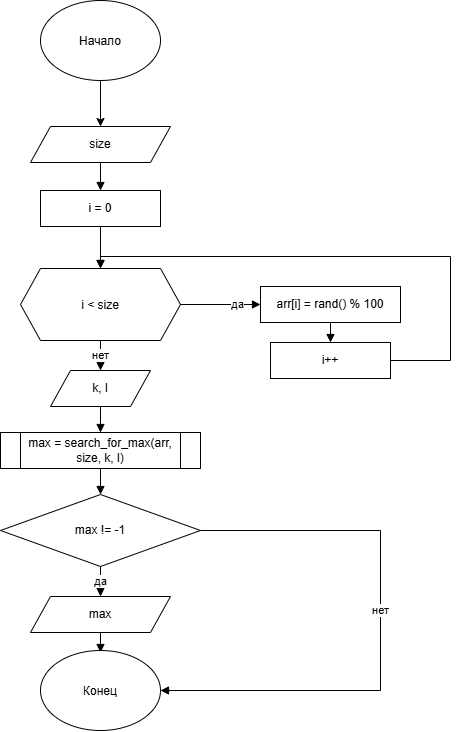
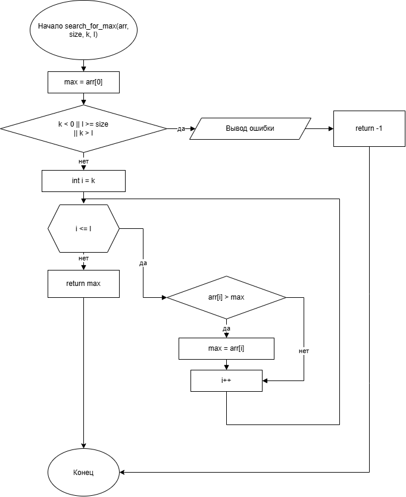

# Домашнее задание к работе номер 14

## Условие задачи

Поиск максимального значения, среди элементов порядковый номер которых лежит в диапазоне [K; L], оформить в виде отдельной функции, которая возвращает найденного значение и принимает в качестве аргументов – указатель на массив, его размер и необходимые для условий поиска параметры.

## 1. Алгоритм и блок-схема

### Алгоритм

1. Начало.

2. Объявить массив типа int и размера N = 1000.

3. Обьявить переменные **size** (макс. размер массива), **k** и **l**.

4. Создать функцию, которая ищет максимальное значение, среди элементов порядковый номер которых лежит в диапазоне [k;l] и возвращает его.

5. Конец.

### Блок-схема

\


## 2. Реализация программы

```c
#define _CRT_SECURE_NO_WARNINGS
#include <stdio.h>
#include <locale.h>
#include <time.h>
#include <stdlib.h>
#define N 1000

int search_for_max(int *arr, int size, int k, int l);

int main(void)
{
    srand((unsigned int)time(NULL));
    setlocale(LC_CTYPE, "RUS");
    int arr[N];
    int size, k, l;
    printf("введите размер массива: ");
    scanf("%d", &size);
    for (int i = 0; i < size; i++) {
        arr[i] = rand() % 100;
    }
    printf("\nвведите значения K и L: ");
    scanf("%d %d", &k, &l);
    int max = search_for_max(arr, size, k, l);
    if (max != -1)
    {
        printf("максимальное значение в диапазоне [%d; %d]: %d\n", k, l, max);
    }
    return 0;
}

int search_for_max(int *arr, int size, int k, int l)
{
    int max = arr[0];
    if (k < 0 || l >= size || k > l)
    {
        printf("ошибка в аргументах\n");
        return -1;
    }
    for (int i = k; i <= l; i++)
    {
        if (arr[i] > max)
        {
            max = arr[i];
        }
    }
    return max;
}
```

## 3. Результаты работы программы

Пример:\
введите размер массива: 100

введите значения K и L: 10 79\
максимальное значение в диапазоне [10; 79]: 99

## 4. Информация о разработчике

Литуновский Максим Дмитриевич, бТИИ-261
